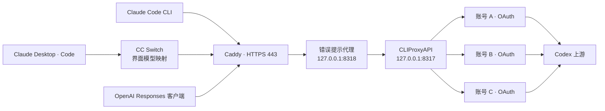

# Codex 订阅自建 API 网关：VPS、CC Switch、Claude Desktop 与多账号切换

这是一份基于实际配置过程整理的中文部署手册，附带错误提示代理、只读模型查询脚本、配置模板和离线测试。目标是在自己的 VPS 上部署 **CLIProxyAPI（CPA）**，让 **Claude Desktop 的 Code 页面、Claude Code CLI 或其他兼容客户端**，通过一个固定网关地址使用自己已授权的 Codex 订阅账号。

推荐阅读顺序：先了解下面的架构，再按 [VPS 部署](docs/01-vps-deployment.md) 操作，完成 [账号授权](docs/02-accounts-and-rotation.md)，最后配置 [CC Switch 与桌面版](docs/03-clients-and-model-mapping.md)。

## 这套方案到底转换什么

这里的“网页端 Codex 转 API”指：在浏览器完成 ChatGPT/Codex 账号 OAuth 授权，由网关管理授权凭证，并向本机软件提供兼容的 API 接口。**它不会把 ChatGPT 订阅转换成 OpenAI Platform 的 API 余额，也不会生成一个官方 API 订阅。**

官方将 ChatGPT 订阅登录与 API key 按用量登录区分为不同方式，见 [OpenAI 认证文档](https://learn.chatgpt.com/docs/auth)。本仓库使用的是第三方网关实现；官方支持某种登录方式，并不等于官方保证 CPA 的协议适配或任意多账号池用法。

本方案不需要从 ChatGPT 网页提取 Cookie，不把账号密码交给 Claude Desktop，也不把 OAuth refresh token 当作客户端 API key。使用自己拥有并获准使用的账号，保留每个账号原有的权限、模型可用性和用量限制。

## 完整调用链



| 组件 | 作用 | 部署位置 |
| --- | --- | --- |
| CC Switch | 配置桌面客户端供应商、显示名称和请求模型 | 本机 |
| Caddy | HTTPS 入口，向内部代理转发 `/v1/*` | VPS |
| 本仓库错误提示代理 | 将明确的额度/账号不可用错误转为易读的终止提示 | VPS |
| CLIProxyAPI | OAuth 凭证管理、协议转换、会话粘性、账号故障切换 | VPS |
| 只读查询工具 | 从服务日志显示实际请求模型，合并重复显示行 | VPS + 本机 |

**账号轮换和协议转换由 CPA 完成。本仓库没有另写一套账号调度器。** 错误代理只处理响应，不保存 OAuth 凭证，不估算剩余额度。

## 实际解决的问题

- 一个账号当前模型额度用尽时，后续可切换到其他可用账号；客户端仍使用同一个网关地址和 key。
- 同一会话优先留在同一账号，减少不必要的缓存重建；子任务可继承父会话账号。
- 全部账号不可用时结束当前网关尝试，显示中文错误；不等待冷却后无限重试。
- 保留 Claude Desktop 的原生模型角色，映射到真实的 Codex 模型 ID，避免菜单名称和请求模型混淆。
- 解释推理强度如何从 Claude 请求转换到 Codex `reasoning.effort`。
- 在 Windows 查询 VPS 路由日志，不需要把 root 密钥放在桌面快捷方式中。
- 明确区分订阅额度、token 统计、缓存命中和客户端估算美元成本。

## 版本与复现边界

CPA 说明以 **v8.0.24** 为基线，核对的源码提交为 `091ff27f31285ec4fd1dd5823b44f7f51fb8f48b`。新配置使用 v8 分组格式；早期根级字段的迁移见部署章节。升级时应对照新版本 `config.example.yaml`，不要假定所有字段永远不变。

CC Switch 部分要求你的版本具有 **Claude Desktop 供应商、模型映射和路由** 功能。不同发行版或分支的界面、支持客户端范围可能不同；如果你的版本没有这些入口，本文不能通过复制 JSON 自动补出该功能。上游项目见 [CC Switch](https://github.com/farion1231/cc-switch)。

模型 ID 使用这次配置中的 `gpt-6.1-sol` 和 `gpt-6-luna`。先核对当前账号和网关实际提供的模型；不要为了让菜单“好看”填写不存在或无权限的模型。

## 文档导航

| 文档 | 内容 |
| --- | --- |
| [01 · VPS 部署](docs/01-vps-deployment.md) | 下载与校验 CPA、目录权限、Python 服务、systemd、Caddy、HTTPS、逐层连通性验证 |
| [02 · 账号授权和轮换](docs/02-accounts-and-rotation.md) | OAuth、多个账号、fill-first、会话粘性、冷却持久化、重试边界、账号恢复 |
| [03 · 客户端与模型映射](docs/03-clients-and-model-mapping.md) | CC Switch、Claude Desktop Code、Claude Code CLI、Responses、URL 与 key 的区别 |
| [04 · 推理强度与模型核验](docs/04-reasoning-and-model-verification.md) | Low/Medium/High/Extra/Max、协议字段、查日志、去重规则、只读 SSH |
| [05 · 错误提示与排障](docs/05-errors-and-troubleshooting.md) | 额度耗尽、认证失效、502、SSE、代理超时、客户端重试、诊断顺序 |
| [06 · 用量、维护与回滚](docs/06-usage-and-maintenance.md) | 缓存、订阅用量、备份、增删账号、升级、回滚、公开发布的脱敏范围 |
| [07 · 验收与固定 Coding 测试](docs/07-validation.md) | 模拟错误测试、端到端验收、可复用任务、哪些情况尚未实测 |

## 仓库文件

```text
.
├── README.md
├── docs/                         # 七个详细章节
├── examples/
│   ├── cpa.config.example.yaml    # CPA v8 示例，没有真实凭证
│   ├── Caddyfile                  # 只开放 API 路径
│   ├── cpa.service
│   ├── codex-error-proxy.service
│   ├── claude-code.env.example    # CLI 配置示意
│   ├── desktop-model-routes.json  # 角色映射参考，不是完整导入包
│   └── query-settings.example.json
├── gateway/codex_error_proxy.py   # API 错误提示代理
├── scripts/
│   ├── codex_model_query.py       # VPS 强制 SSH 命令
│   ├── Query-CodexModel.ps1       # Windows 只读查询
│   ├── Query-CodexModel.cmd
│   └── smoke_test.py              # 显式发送一次小请求
├── tests/                        # 离线测试，不消耗订阅额度
├── requirements.txt
├── SECURITY.md
├── THIRD_PARTY_NOTICES.md
└── LICENSE
```

## 最短部署路线

1. 准备 Linux VPS、一个解析到 VPS 的域名、能使用 Codex 的自有账号。
2. 安装固定版本 CPA 到 `/opt/cpa/cli-proxy-api`。
3. 把示例配置复制到 `/opt/cpa/config.yaml`，替换客户端 key；凭证目录设为 `/var/lib/cpa/auths`。
4. 分别完成账号 OAuth 授权，确认生成的是不同账号的凭证。
5. 启动 CPA，再部署本仓库错误提示代理，最后配置 Caddy。
6. CC Switch 中添加 Claude Desktop 供应商：Base URL 为 `https://gateway.example.com`，Token 为自己设置的网关 key。
7. 配置桌面角色到 Codex 模型的映射，选择供应商，重启/新建 Code 会话。
8. 发送短请求，核对网关日志，再验证工具调用和推理强度。
9. 多账号设置使用 `fill-first + session-affinity + 冷却持久化`；关闭额外重试轮次。
10. 运行离线错误测试，确认全部不可用时显示明确提示。

每一步的具体命令、检查方法和失败处理都在详细章节中。不要直接把模板覆盖到已有生产服务器。

## 账号轮换的核心配置

```yaml
routing:
  strategy: fill-first
  session-affinity: true
  session-affinity-ttl: "24h"
  session-affinity-subagents: true
  retry:
    request-retry: 0
    max-retry-credentials: 0
    max-retry-interval: 0
  cooldown:
    disable-cooling: false
    save-cooldown-status: true
    transient-error-cooldown-seconds: 60
```

三个 `0` 含义不同：`request-retry: 0` 关闭额外重试轮次；`max-retry-credentials: 0` 允许初始轮尝试所有符合条件的凭证；`max-retry-interval: 0` 不等待冷却。这些配置**不会关闭初始轮的账号切换**，也不承诺任何客户端完全不重试。具体边界见 [轮换章节](docs/02-accounts-and-rotation.md)。

## 全部不可用时的提示

上游明确返回额度耗尽代码时，代理返回：

```json
{
  "type": "error",
  "error": {
    "type": "invalid_request_error",
    "code": "codex_quota_exhausted",
    "upstream_code": "usage_limit_reached",
    "upstream_status": 429,
    "message": "所有可用 Codex 账号在当前模型上的额度均已用尽，请等待额度重置后重试。"
  }
}
```

如果上游只能说明“没有可用账号”，提示会保留认证失效、冷却等可能性，**不会把所有失败都说成额度用完**。默认用 HTTP 400 表达终止错误，降低常见 SDK 对 429/503 的自动重试；这属于本仓库的兼容策略，原始状态保存在 `upstream_status` 中。正文说明可能只出现在桌面版的“查看详情”里。

## 测试和证据

```bash
python -m pip install -r requirements.txt
python -m unittest discover -s tests -v
```

离线测试覆盖错误分类、状态保留、SSE 转发、模型日志脱敏和去重。它们不连接 OpenAI，也不故意耗尽真实账号。正常请求曾在实际部署中运行；**四个真实账号同时耗尽的端到端情况未人为制造**。公开模板仍需在自己的环境逐层验收，见 [验证说明](docs/07-validation.md)。

## 来源与归属

- [CLIProxyAPI 上游](https://github.com/router-for-me/CLIProxyAPI) 与 [v8.0.24 配置](https://github.com/router-for-me/CLIProxyAPI/blob/v8.0.24/config.example.yaml)：协议转换、OAuth 和账号调度实现。
- [OpenAI 官方认证说明](https://learn.chatgpt.com/docs/auth)：订阅登录与按用量 API 登录的区别。
- [GPT-6.1 Sol 模型说明](https://developers.openai.com/api/docs/models/gpt-6.1-sol)：支持的推理强度和工具调用接口。
- [Claude Code 模型配置](https://code.claude.com/docs/en/model-config)：CLI 的模型配置能力。

本仓库只发布自己的说明、辅助代码和脱敏模板，不包含 CPA 二进制、第三方客户端源码、账户密码、OAuth 凭证、真实 VPS 地址或真实请求正文。辅助代码采用 MIT；依赖项目保留其各自的许可。
