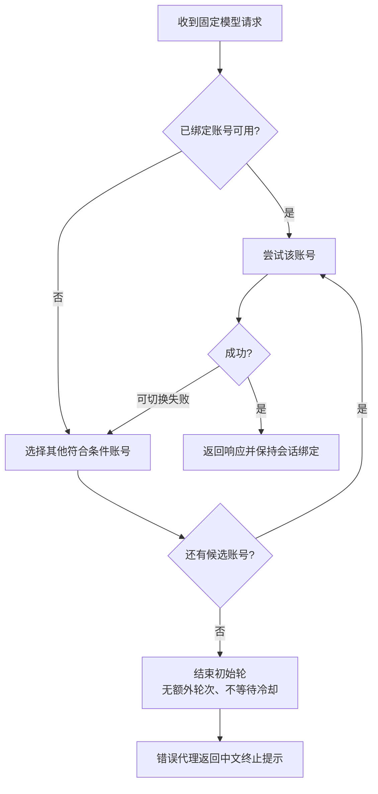

# 02 · 账号授权、自动切换与恢复

[返回首页](../README.md) · 上一章：[VPS 部署](01-vps-deployment.md) · 下一章：[客户端配置](03-clients-and-model-mapping.md)

## 1. 账号池的含义

每个账号单独完成 OAuth 授权，CPA 保存各自的访问与刷新凭证。客户端只持有网关 key，CPA 负责选择可用账号和执行转换。增加账号不会提升单个账号的权限，也不会把额度合并到某个官方总余额里。

示例使用账号 A/B/C 表述，不发布真实邮箱或账号 ID。三份同一账号的 auth 文件仍是同一个账号，不是三份独立额度。授权时要确认浏览器当前账号，避免重复导入。

## 2. 首选：设备授权流程

在支持设备授权的账号上，可在 VPS 运行：

```bash
sudo -u cpa /opt/cpa/cli-proxy-api \
  --config /opt/cpa/config.yaml --codex-device-login
```

按 CPA 实际输出的官方验证地址，在自己的浏览器输入短期设备代码并登录账号 A。授权页面的域名、账号和权限应与你预期一致。不要将设备代码发到公开聊天或 Issue。

授权完成后 CPA 将凭证存入配置的 `oauth.auth-dir`。设备登录是否可用受账号/工作区设置影响，不能通过本仓库保证。若上游显示不支持，使用下一节浏览器回调方式。

## 3. 浏览器 OAuth 回调方式

CPA v8.0.24 的 Codex 回调默认是 `http://localhost:1455/auth/callback`。浏览器在本机、程序在 VPS 时，这个 localhost 指向本机，因此需要隧道。

在本机打开一个终端：

```powershell
ssh -N -L 1455:127.0.0.1:1455 admin@203.0.113.10
```

在另一个 VPS 终端运行：

```bash
sudo -u cpa /opt/cpa/cli-proxy-api \
  --config /opt/cpa/config.yaml --codex-login --no-browser
```

在本机浏览器打开程序输出的授权 URL，完成账号 A 授权，回调通过 SSH 隧道到达 VPS。完成后关闭授权用隧道。该回调端口不需要向公网开放。

若本机 1455 已被另一个登录进程占用，先结束冲突的授权进程。CPA 提供 `--oauth-callback-port`，但修改端口涉及 redirect URI，必须核对上游是否接受；不要盲目改成另一个公网端口。

## 4. 加入第二、第三个账号

重复同样的授权流程，但先在浏览器切换到正确账号，或使用独立浏览器 profile。每次完成后检查 auth 目录新增/修改的文件数量和时间，确认不同账号独立存在。

```bash
sudo find /var/lib/cpa/auths -maxdepth 1 -type f -name '*.json' -printf '%f\n'
sudo chown -R cpa:cpa /var/lib/cpa/auths
sudo chmod 0700 /var/lib/cpa/auths
sudo find /var/lib/cpa/auths -maxdepth 1 -type f -exec chmod 0600 {} \;
```

文件名也可能包含账号标识，输出只在自己的管理员终端查看，不发公开截图。不要 `cat` 全部凭证。若从本机授权再上传，必须使用 CPA 自己生成并支持的格式；官方 Codex `auth.json` 不应被假定能直接重命名导入。

上传方式可以用 SCP，但认证文件仅进入 `/var/lib/cpa/auths`，不进入 `/opt/codex-gateway` 这个 Git checkout。复制 OAuth 凭证相当于复制账号授权能力，按秘密文件保存。

## 5. 为什么选择 fill-first + 会话粘性

| 策略 | 行为倾向 | 适合的场景 | 代价 |
| --- | --- | --- | --- |
| `round-robin` | 在候选账号间轮流选择 | 重视分散负载/并发 | 长会话可能更频繁建立缓存 |
| `fill-first` | 优先使用候选顺序/优先级中的可用账号 | 希望先稳定使用一个，再失效切换 | 不保证新会话平均分摊额度 |
| 会话粘性 | 已绑定会话优先继续使用该账号 | Coding 长上下文 | 失效后仍需切换，缓存不保证保留 |

这里的 fill-first 不是“把 A 的所有模型额度耗尽才看 B”的严格计费规则。CPA 选择的是**当前请求模型可用的候选账号**。模型权限、冷却、优先级和既有会话绑定都会影响选择。账号 A 的一个模型不可用，不一定代表其全部模型额度用尽。

```yaml
routing:
  strategy: fill-first
  session-affinity: true
  session-affinity-ttl: "24h"
  session-affinity-subagents: true
```

CPA 优先识别客户端会话头、prompt cache key、Responses 会话标识等；缺少稳定标识时会尝试其他派生信息。是否能稳定识别你的客户端，需要实际日志验证。

`24h` 表示会话与账号绑定的保留时间，不是额度重置时间。`session-affinity-subagents: true` 让可识别父会话的子任务继承父账号，可减少不必要的缓存分散。

既有绑定优先于账号优先级：会话已经转到 B 后，即使更高优先级 A 恢复，也不会为了优先级立刻迁回 A。优先级主要影响新绑定、无会话请求和失效后的重新绑定。

## 6. 一次请求如何切换



这是调度行为示意图，不是替代 CPA 实现的伪代码。哪些错误允许切换、响应已开始后是否还能切换，以 CPA 和上游协议为准。**SSE 已经发出内容后，不保证无缝换账号继续同一次响应。**

## 7. 不无限重试的三个参数

```yaml
routing:
  retry:
    request-retry: 0
    max-retry-credentials: 0
    max-retry-interval: 0
requests:
  streaming:
    bootstrap-retries: 0
```

| 参数 | 0 的准确含义 | 常见误解 |
| --- | --- | --- |
| `request-retry` | 初始轮之后不再追加账号重试轮次 | 误认为不能尝试 B/C |
| `max-retry-credentials` | 每轮不限制不同凭证数量，尝试符合条件的全部凭证 | 误认为一次都不尝试或无限循环 |
| `max-retry-interval` | 不为冷却等待而阻塞重试 | 误认为所有账号不设冷却 |
| `bootstrap-retries` | 不追加首字节发出前的流式重启尝试 | 误认为关闭初始轮路由故障切换 |

因此，三个账号可在初始轮依次被考虑，但用完候选后结束。并不意味着请求只有一次网络访问，整体等待可能包含每个候选的网络等待。账号池太大或上游很慢时仍可能等待较久，HTTP 客户端超时与账号数量需要另行规划。

上游说明支持凭证/提供商层级的显式重试覆盖。若某个 auth 配了非负 `request_retry` 或对应版本支持的 `request-retry` 覆盖，可能覆盖全局设置。要达到“不追加轮次”，检查这些覆盖值；不确定字段时对照该版本源码和示例。不要只改 YAML 后就宣称所有路径都没有重试。

同时检查 SDK、CC Switch 和 Claude Desktop 自身是否存在自动重试。网关有界不代表客户端完全有界。错误代理默认把已识别的最终不可用错误变为 400，降低常见 SDK 对 429/503 的重试。任意客户端仍可能自行循环，需要其自身停止策略。

## 8. 冷却与持久化

```yaml
routing:
  cooldown:
    disable-cooling: false
    save-cooldown-status: true
    transient-error-cooldown-seconds: 60
```

冷却让最近失败的账号/模型暂时退出候选。额度错误的恢复时间由上游重置信息、CPA 解析结果或退避逻辑决定；`60` 秒只针对相应的临时错误冷却，不能把它理解为订阅额度一分钟就恢复。

`save-cooldown-status: true` 将状态保存在 auth 文件旁边的 `.cds` 文件，服务重启后不立即忘记已知不可用状态。目录必须允许 cpa 写入。它保存的是调度状态，不是官方账单或精确额度证明。

不要为了“重新能用”反复删除 `.cds`、关闭冷却或重启服务；这不能恢复真实额度，可能让同一失败反复发生。账号确已恢复但状态仍未更新时，先核对上游和管理状态，再做受控恢复。

## 9. 全部账号不可用的两种消息

| CPA 提供的信息 | 面向用户的提示 |
| --- | --- |
| 明确额度代码，例如 `usage_limit_reached` | 所有可用 Codex 账号在当前模型上的额度均已用尽，请等待额度重置后重试。 |
| `auth_unavailable` / `model_cooldown` 等 | 当前没有可用的 Codex 账号：可能额度已用尽、账号正在冷却或认证失效。请稍后重试或检查账号状态。 |

代理依据 CPA 最终响应分类，没有独立查询所有账号的实时剩余额度。只有上游明确报告的情况才显示额度提示；如果混合认证失败和额度失败，聚合响应可能不足以描述每个账号，此时应结合私有管理状态确认。

它不会改用更便宜模型掩盖失败，也不会偷偷转到另外一个收费 API 供应商。本仓库示例没有配置模型降级或计费备用供应商。

## 10. 新账号、移除账号与恢复

- **新增**：完成 OAuth、校验身份、确认文件权限，查看 CPA 是否加载；必要时受控重启。不同版本的热加载行为应现场确认。
- **临时停用**：使用上游版本支持的管理停用功能，或停服务后将该 auth 和对应 `.cds` 移到私有隔离目录，确认不再被扫描。
- **删除**：先停止/排空相关请求，再移出授权文件；需要撤销上游授权时到账号自身的授权管理界面处理，删本地文件不等于撤销已泄露 token。
- **额度恢复**：等待真实重置，检查账号状态。B 上已有会话可以继续使用 B；新会话可按候选策略重新选择。
- **认证失效**：重新授权受影响账号，核对文件更新，不要通过复制同一坏凭证生成更多“账号”。

`fill-first` 的排序不应通过随意改文件名推断。需要明确优先级时，使用该版本支持的账号元数据/管理功能，先在测试账号池验证。不要在长会话里频繁改策略，避免增加缓存和诊断噪音。

## 11. 额度查询与模型查询不是一回事

本仓库的本机脚本只显示时间、上游类型和请求模型，不显示账号邮箱、剩余额度百分比或重置倒计时。若需要这些信息，使用 CPA 对应版本的私有管理面板/配额检查功能，并把管理入口限制在本机或 SSH 隧道中。

不要凭“还有三个 auth 文件”推断“还有三份额度”，也不要凭某个模型的一次 429 推断整池所有模型都不可用。轮换策略只改善可用性；真实额度和模型权限仍来自各个账号的上游服务。
